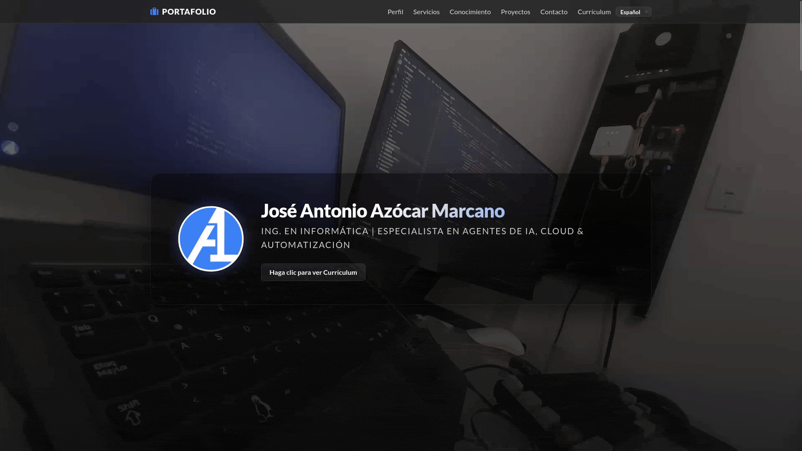

# 📑 Portafolio Profesional - José Azócar


Vitrina digital y hub de servicios profesionales para **José Azócar**, Ing. en Informática | Especialista en Agentes de IA, Cloud & Automatización. La plataforma está desarrollada bajo una arquitectura **Single Page Application (SPA)** de alto rendimiento con capacidades **Serverless**, diseñada para ofrecer una navegación ágil, adaptativa y totalmente segura.

<div align="center">
    
</div>

🌐 **Sitio Web en Producción:** [joseazocar.pro](https://joseazocar.pro/)

---

## 📋 Tabla de Contenidos

- [Propósito y Visión General](#-propósito-y-visión-general)
- [Arquitectura y Estructura de Directorios](#-arquitectura-y-estructura-de-directorios)
- [Stack Tecnológico y Dependencias Clave](#-stack-tecnológico-y-dependencias-clave)
- [Patrones de Diseño y Decisiones Técnicas](#-patrones-de-diseño-y-decisiones-técnicas)
- [Análisis de Netlify Functions y Variables de Entorno](#-análisis-de-netlify-functions-y-variables-de-entorno)
- [Puntos de Entrada y Ciclo de Ejecución](#-puntos-de-entrada-y-ciclo-de-ejecución)
- [Instalación y Configuración Local](#-instalación-y-configuración-local)
- [Licencia y Propiedad Intelectual](#-licencia-y-propiedad-intelectual)

---

## 🎯 Propósito y Visión General

Esta plataforma web actúa como la vitrina profesional principal de **José Azócar**, diseñada para proyectar su especialización técnica y facilitar la contratación de servicios o el contacto profesional directo.

### Problema que Resuelve y Caso de Uso
* **Oferta Integral de Servicios:** Presenta de forma clara las áreas de especialidad en Ingeniería de Software, desarrollo de **Agentes de IA**, arquitectura **Cloud** y **Automatización de Procesos**, junto con el catálogo de proyectos ejecutados.
* **Canal de Contacto Directo y Seguro:** Permite a potenciales clientes y reclutadores iniciar una conversación directa vía WhatsApp sin exponer datos sensibles del propietario ni permitir tráfico automatizado no deseado (spam).
* **Experiencia de Usuario Continua:** Reemplaza la navegación web tradicional por una interfaz responsiva de página única (SPA), eliminando las recargas de página y garantizando tiempos de respuesta inmediatos.

### Objetivos Clave
* **Showcase de Servicios y Proyectos:** Exposición modular de competencias técnicas, soluciones desarrolladas y demostraciones interactivas.
* **Seguridad y Privacidad (Zero-Exposure):** Protección total de datos de contacto mediante funciones serverless backend que intermedian la conexión a WhatsApp tras validar un desafío antispam (**Google reCAPTCHA**).
* **Posicionamiento y Rendimiento:** Estructura web optimizada para motores de búsqueda (SEO mediante `robots.txt` y `sitemap.xml`) con carga acelerada mediante Vite.

---

## 📁 Arquitectura y Estructura de Directorios

```text
portafolio/
├── assets/             # Recursos estáticos adicionales e imágenes
├── docs/
│   └── prompts/        # Documentación técnica y artefactos de contexto
├── netlify/
│   └── functions/      # Backend Serverless (Node.js) para validación de reCAPTCHA y proxy de WhatsApp
├── src/                # Módulos fuente principales (JavaScript ES6+, lógica, estilos)
├── .gitignore          # Reglas de exclusión para Git
├── index.html          # Punto de entrada HTML5 y orquestador del DOM
├── LICENSE             # Términos de la licencia MIT
├── package.json        # Configuración del proyecto, scripts npm y dependencias
├── package-lock.json   # Árbol de dependencias congelado
├── README.md           # Documentación principal del repositorio
├── robots.txt          # Reglas de indexación para web crawlers
└── sitemap.xml         # Mapa del sitio para motores de búsqueda
```

---

## 🛠 Stack Tecnológico y Dependencias Clave

### Distribución del Código Base
* **CSS3:** 34.1%
* **JavaScript (ES6+):** 33.8%
* **HTML5:** 32.1%

### Herramientas y Frameworks
* **Build Tooling:** [Vite](https://vitejs.dev/) para compilación, servidor de desarrollo local (`npm run dev`) y empaquetado optimizado gestionado por `npm`.
* **Backend Runtime & Security:** [Netlify Functions](https://www.netlify.com/products/functions/) (Node.js) para ejecución de lógica serverless, **Google reCAPTCHA** para validación antispam y proxy seguro hacia WhatsApp.
* **Estilización y Diseño:** Metodología **BEM (Block Element Modifier)** para CSS modular, Google Fonts, Font Awesome y efectos dinámicos con Animate On Scroll (AOS).

---

## 🏛 Patrones de Diseño y Decisiones Técnicas

1. **Patrón Serverless Proxy (Zero-Exposure):** Las funciones en `/netlify/functions/` evitan exponer el número telefónico de WhatsApp o credenciales en el HTML/JS del cliente. El frontend realiza una petición enviando el token de reCAPTCHA; la función lo valida con Google y procesa la interacción utilizando las variables de entorno almacenadas privadamente en Netlify.
2. **Validación Antispam Server-Side:** Handshake en servidor con la API de Google reCAPTCHA antes de procesar cualquier acción de contacto.
3. **Arquitectura SPA (Single Page Application):** Manejo de navegación en el cliente para evitar recargas completas del navegador, garantizando fluidez UX.
4. **Metodología BEM (Block Element Modifier):** Desacoplamiento estricto de reglas CSS mediante nombres estructurados, previniendo colisiones de estilos.
5. **Estrategia Performance-First & Mobile-First:** Maquetación adaptativa mediante Flexbox/Grid con optimización de tiempos de carga mediante el bundling de Vite.

---

## 🔐 Análisis de Netlify Functions y Variables de Entorno

Las credenciales y datos privados no se almacenan en el repositorio de código. Se configuran centralizadamente en el panel de **Netlify** (*Site configuration > Environment variables*):

| Variable de Entorno | Ámbito | Descripción y Uso |
| :--- | :--- | :--- |
| `PHONE_NUMBER` / `TEL_NUMBER` | Serverless (Backend) | Número telefónico de destino para mensajes de WhatsApp. Almacenado exclusivamente en Netlify para garantizar **Zero-Exposure** en el cliente. |
| `RECAPTCHA_SECRET_KEY` | Serverless (Backend) | Clave privada de Google reCAPTCHA utilizada por la función en `/netlify/functions/` para validar los tokens antispam. |
| `VITE_RECAPTCHA_SITE_KEY` | Frontend (Client) | Clave pública inyectada por Vite en el navegador para solicitar la verificación al usuario. |

### Configuración para Desarrollo Local

1. Crear un archivo `.env` en la raíz del proyecto (incluido en `.gitignore`):
   ```env
   PHONE_NUMBER=584XXXXXXXXX
   RECAPTCHA_SECRET_KEY=tu_clave_secreta_local
   VITE_RECAPTCHA_SITE_KEY=tu_clave_publica_local
   ```
2. Ejecutar el entorno de desarrollo emulado con Netlify CLI:
   ```bash
   npx netlify dev
   ```

---

## 🔄 Puntos de Entrada y Ciclo de Ejecución

1. **Inicialización Frontend:**
   * El navegador carga `index.html`. Vite compila e inyecta los módulos fuente desde `/src`.
2. **Interacción y Desafío de Seguridad:**
   * Al hacer clic en el botón de contacto/WhatsApp, el cliente solicita un token a Google reCAPTCHA mediante `VITE_RECAPTCHA_SITE_KEY`.
3. **Procesamiento Serverless (Zero-Exposure):**
   * El cliente envía el token a la Netlify Function alojada en `/netlify/functions/`.
   * La función valida el token con la API de Google usando `RECAPTCHA_SECRET_KEY`.
   * Tras la validación exitosa, la función lee la variable `PHONE_NUMBER` almacenada en el entorno de Netlify y construye o ejecuta la redirección hacia la API de WhatsApp, retornándola al cliente sin revelar el número en el código fuente.

---

## 💻 Instalación y Configuración Local

### Prerrequisitos
* [Node.js](https://nodejs.org/) (v16+ recomendado) y `npm` instalados en el entorno local.

### Pasos de Ejecución

1. **Clonar el repositorio:**
   ```bash
   git clone https://github.com/azocarone/portafolio.git
   cd portafolio
   ```

2. **Instalar dependencias:**
   ```bash
   npm install
   ```

3. **Ejecutar el servidor de desarrollo:**
   * **Opción A (Recomendada con Serverless + WhatsApp + reCAPTCHA):**
     ```bash
     npx netlify dev
     ```
   * **Opción B (Solo Frontend Vite):**
     ```bash
     npm run dev
     ```

   *Opción alternativa (Legacy):* Abrir el archivo `index.html` utilizando la extensión **Live Server** en VS Code.

---

## ⚖ Licencia y Propiedad Intelectual

Este proyecto se distribuye bajo la **Licencia MIT**. La infraestructura de código es de libre exploración y uso, mientras que el contenido personal y la trayectoria profesional son propiedad intelectual de **José Azócar**.

---

<br>

<p align="center">
    
    <div align="right">
        <strong>José Antonio Azócar Marcano</strong><br>
        Ing. Informático | Especialista en Agentes de IA, Cloud & Automatización.<br>
        ⬆ <a href="#-portafolio-profesional---josé-azócar">Up</a>
    </div>
    <br clear="all">
</p>